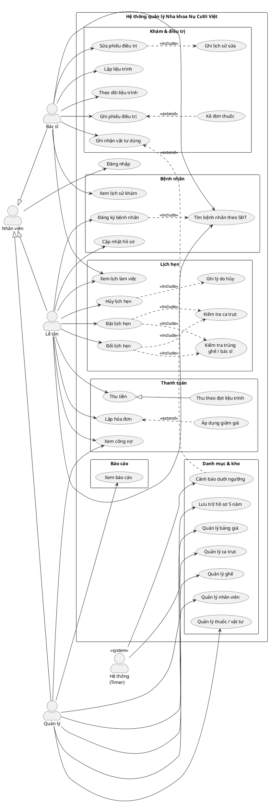

# Phân tích Use Case — Hệ thống web quản lý Nha khoa Nụ Cười Việt

> Nguồn: Bài tập 1 · Đề bài (2/2) — luật phòng khám, ba điểm không thống nhất, tám câu hỏi của quản lý.

## 1. Tác nhân (Actor)

| Tác nhân | Vai trò trong hệ thống |
|---|---|
| **Nhân viên** (trừu tượng) | Tác nhân cha: đăng nhập, đổi mật khẩu. Ba tác nhân dưới kế thừa. |
| **Lễ tân** | Tiếp nhận bệnh nhân, xếp/đổi/hủy lịch, lập hóa đơn, thu tiền. |
| **Bác sĩ** | Xem lịch của mình, ghi phiếu điều trị, kê thuốc, lập liệu trình, ghi vật tư dùng. |
| **Quản lý** | Quản lý danh mục (bảng giá, ghế, ca trực, thuốc/vật tư), nhập kho, xem báo cáo. |
| **Hệ thống (Timer)** | Tác nhân phụ: tự cảnh báo vật tư dưới ngưỡng, tự đánh dấu hồ sơ hết hạn lưu trữ (5 năm). |

> Bệnh nhân **không** là tác nhân: đề bài không yêu cầu bệnh nhân tự đặt lịch online. Mọi thao tác đều do nhân viên phòng khám thực hiện.

## 2. Danh sách Use Case theo nhóm

### A. Quản lý bệnh nhân
| Mã | Use case | Tác nhân | Luật liên quan |
|---|---|---|---|
| UC01 | Tìm bệnh nhân theo số điện thoại | Lễ tân, Bác sĩ | Nhận biết bằng SĐT; trùng tên là bình thường |
| UC02 | Đăng ký bệnh nhân mới | Lễ tân | Trẻ < 15 tuổi dùng SĐT người giám hộ (xem QĐ2) |
| UC03 | Cập nhật hồ sơ bệnh nhân | Lễ tân | |
| UC04 | Xem lịch sử khám của bệnh nhân | Bác sĩ, Lễ tân | Giữ hồ sơ 5 năm |

### B. Lịch hẹn
| Mã | Use case | Tác nhân | Luật liên quan |
|---|---|---|---|
| UC05 | Đặt lịch hẹn | Lễ tân | 1 lịch = 1 bác sĩ + 1 ghế + 1 khung 30 phút |
| UC05a | «include» Kiểm tra trùng ghế / trùng bác sĩ | — | Không có hai lịch trùng giờ trên cùng ghế hoặc bác sĩ |
| UC05b | «include» Kiểm tra ca trực bác sĩ | — | Chỉ xếp vào ca bác sĩ đó trực |
| UC06 | Đổi lịch hẹn | Lễ tân | Lặp lại UC05a, UC05b |
| UC07 | Hủy lịch hẹn | Lễ tân | «include» Ghi lý do, người hủy, thời điểm hủy |
| UC08 | Xem lịch làm việc | Bác sĩ, Lễ tân | |

### C. Khám và điều trị
| Mã | Use case | Tác nhân | Luật liên quan |
|---|---|---|---|
| UC09 | Ghi phiếu điều trị | Bác sĩ | Một lần khám nhiều việc; mỗi việc ghi số răng (xem QĐ1) |
| UC10 | Sửa phiếu điều trị | Bác sĩ | «include» Ghi lịch sử sửa (ai sửa, lúc nào) |
| UC11 | Kê đơn thuốc | Bác sĩ | «extend» UC09; ghi liều dùng và số lượng |
| UC12 | Ghi nhận vật tư sử dụng | Bác sĩ | «include» Trừ tồn kho |
| UC13 | Lập liệu trình (niềng, implant…) | Bác sĩ | Gom nhiều buổi, chia đợt thanh toán |
| UC14 | Theo dõi tiến độ liệu trình | Bác sĩ, Lễ tân | Liệu trình đang dở, còn mấy buổi |

### D. Thanh toán
| Mã | Use case | Tác nhân | Luật liên quan |
|---|---|---|---|
| UC15 | Lập hóa đơn | Lễ tân | «include» Chốt giá tại thời điểm lập (giá đổi sau không ảnh hưởng) |
| UC16 | Áp dụng giảm giá | Lễ tân | «extend» UC15 (xem QĐ3) |
| UC17 | Thu tiền | Lễ tân | Một hóa đơn thu nhiều lần; ghi tiền mặt / chuyển khoản |
| UC18 | Thu tiền theo đợt liệu trình | Lễ tân | Kế thừa UC17 |
| UC19 | Xem công nợ hóa đơn / bệnh nhân | Lễ tân, Quản lý | Luôn biết hóa đơn còn nợ bao nhiêu |

### E. Danh mục và kho
| Mã | Use case | Tác nhân | Luật liên quan |
|---|---|---|---|
| UC20 | Quản lý bảng giá dịch vụ | Quản lý | Giá có hiệu lực theo khoảng thời gian |
| UC21 | Quản lý ca trực bác sĩ | Quản lý | Ca trực theo ngày |
| UC22 | Quản lý ghế nha khoa | Quản lý | |
| UC23 | Quản lý nhân viên & phân quyền | Quản lý | |
| UC24 | Quản lý thuốc / vật tư, nhập kho | Quản lý | Thiết lập ngưỡng tối thiểu |
| UC25 | Cảnh báo vật tư dưới ngưỡng | Hệ thống | «extend» UC12 khi tồn kho < ngưỡng |
| UC26 | Lưu trữ / khóa hồ sơ hết hạn 5 năm | Hệ thống | Không cho xóa hồ sơ trước 5 năm |

### F. Báo cáo (8 câu hỏi của quản lý)
`UC27 Xem báo cáo` là use case cha, 8 báo cáo con kế thừa:

| Mã | Báo cáo | Dữ liệu cần có |
|---|---|---|
| UC27.1 | Doanh thu từng bác sĩ trong tháng | Bác sĩ thực hiện từng dòng dịch vụ (QĐ1) |
| UC27.2 | Ghế trống nhiều nhất, theo khung giờ | Lịch hẹn × ghế × khung 30 phút |
| UC27.3 | Bệnh nhân quá 6 tháng chưa quay lại | Ngày khám gần nhất |
| UC27.4 | Dịch vụ hay bị hủy lịch nhất, vì lý do gì | Lý do hủy (UC07) |
| UC27.5 | Tổng tiền khách còn nợ, theo từng người | Hóa đơn − các lần thu (UC17) |
| UC27.6 | Liệu trình đang dở, còn mấy buổi | UC14 |
| UC27.7 | Thuốc / vật tư sắp hết | Tồn kho vs ngưỡng |
| UC27.8 | Doanh thu tăng/giảm % so với tháng trước | Thu tiền theo tháng |

## 3. Sơ đồ Use Case (PlantUML)

> Xem trong VS Code bằng extension **PlantUML**, hoặc dán vào https://www.plantuml.com/plantuml

## 4. Ba điểm phòng khám làm mỗi lần một kiểu — đề xuất quyết định

Ghi lựa chọn chính thức vào `database/quyet-dinh.md`.

| # | Vấn đề | Đề xuất | Lý do | Ảnh hưởng use case |
|---|---|---|---|---|
| QĐ1 | Hai bác sĩ cùng làm một buổi, hồ sơ ghi hai tên | Lịch hẹn giữ **1 bác sĩ chính**; **mỗi dòng việc** trong phiếu điều trị ghi bác sĩ thực hiện | Giữ đúng luật "1 lịch = 1 bác sĩ", vẫn tính được doanh thu từng bác sĩ (UC27.1) | UC09, UC27.1 |
| QĐ2 | Trẻ < 15 tuổi dùng SĐT mẹ, anh chị em chung số | Mỗi trẻ là **một bệnh nhân riêng**; SĐT là thuộc tính của **người liên hệ**, một SĐT tra ra **danh sách** bệnh nhân | Không gộp hồ sơ y tế của hai người; tra SĐT vẫn nhanh | UC01, UC02 |
| QĐ3 | Giảm giá lúc ghi ở tổng, lúc ghi ở từng dòng | Lưu giảm giá **ở từng dòng**; giảm ở tổng thì hệ thống **phân bổ** theo tỷ lệ tiền các dòng | Báo cáo doanh thu theo bác sĩ / dịch vụ luôn đúng | UC16, UC27.1, UC27.8 |
